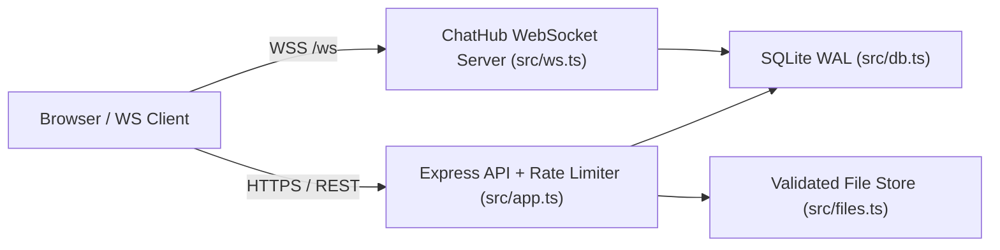

# Koral Chat

Self-hosted real-time team chat platform built with TypeScript, Express, WebSockets (`ws`), and SQLite (`node:sqlite`).

## Purpose & Problem Statement

Teams that need real-time chat on private infrastructure often face bloated external SaaS dependencies or complex multi-service stacks. Koral Chat runs as a single lightweight Node.js service with built-in SQLite storage, providing multi-channel WebSocket messaging, live presence, authenticated file sharing, rate limiting, and moderation controls out of the box.

## Features

- **Real-Time WebSocket Messaging**: Channel-scoped broadcast via `ws` at `/ws` with live online user presence updates.
- **User Accounts & Role Assignment**: Scrypt password hashing (`crypto.scryptSync` + `crypto.timingSafeEqual`), 12-hour JWT session tokens, and automatic `admin` assignment for the first registered user.
- **Persistent SQLite History**: Built-in `node:sqlite` (WAL mode) storing users, channels, messages, uploaded files, and moderation audit logs.
- **Validated File Sharing**: Extension allowlist (`.png`, `.jpg`, `.jpeg`, `.webp`, `.gif`, `.txt`, `.md`, `.pdf`, `.json`), byte size limits, and UUID filenames preventing path traversal.
- **Admin Moderation & Audit Trail**: Mute/unmute users, delete messages with real-time client removal events, and inspect moderation audit logs.
- **Security & Observability**: Helmet HTTP headers, per-IP rate limiting (`express-rate-limit`), and structured JSON HTTP request logging.

## Tech Stack

- **Runtime & Framework**: Node.js 22.5+, TypeScript, Express 4, `ws`
- **Database**: Built-in `node:sqlite` (`DatabaseSync`)
- **Security**: `helmet`, `express-rate-limit`, `jsonwebtoken`, `node:crypto` (`scryptSync`)

## System Requirements

- Node.js 22.5 or newer (for `node:sqlite`)

## Installation

```bash
git clone https://github.com/fully-ai/koral-chat.git
cd koral-chat
npm ci
npm run build
```

## Configuration

Copy `.env.example` to `.env` or set environment variables:

| Variable | Default | Description |
| --- | --- | --- |
| `KORAL_HOST` | `127.0.0.1` | Bind address |
| `KORAL_PORT` | `3000` | HTTP and WebSocket port |
| `KORAL_JWT_SECRET` | random per boot | JWT HMAC secret (set explicitly in production) |
| `KORAL_DATA_DIR` | `./data` | SQLite database and upload directory |
| `KORAL_MAX_UPLOAD_BYTES` | `5242880` | Max file size in bytes (5 MiB) |
| `KORAL_RATE_LIMIT_MAX` | `120` | Max requests per IP per minute |

## Running & Usage Examples

```bash
KORAL_JWT_SECRET="replace-with-random-secret" npm start
```

Example API calls:

```bash
# Register first user (admin)
curl -s -X POST http://127.0.0.1:3000/api/auth/register \
  -H 'Content-Type: application/json' \
  -d '{"username":"alice","password":"strongpassword"}'

# Create a channel
curl -s -X POST http://127.0.0.1:3000/api/channels \
  -H "Authorization: Bearer <TOKEN>" \
  -H 'Content-Type: application/json' \
  -d '{"name":"ops","description":"Operations room"}'
```

## API Documentation

| Method & Path | Auth | Description |
| --- | --- | --- |
| `GET /api/health` | Public | Health check and current online user count |
| `POST /api/auth/register` | Public | Register account (first user receives `admin` role) |
| `POST /api/auth/login` | Public | Authenticate and issue JWT |
| `GET /api/auth/me` | Bearer | Current user profile |
| `GET /api/channels` / `POST /api/channels` | Bearer | List or create channels |
| `GET /api/channels/:id/messages` | Bearer | Retrieve up to 100 recent channel messages |
| `POST /api/files` / `GET /api/files/:id` | Bearer | Upload and retrieve shared files |
| `GET /api/admin/users` | Admin | List registered users and mute state |
| `POST /api/admin/users/:id/mute` | Admin | Mute or unmute a user |
| `DELETE /api/admin/messages/:id` | Admin | Delete message and notify connected clients |
| `GET /api/admin/audit` | Admin | List admin moderation audit logs |
| `WS /ws?token=<jwt>` | JWT | WebSocket events (`join`, `chat`, `message`, `presence`, `message_deleted`) |

## Architecture



## File Structure

```
koral-chat/
├── src/
│   ├── app.ts            # Express routes, Helmet, rate limiting, request logger
│   ├── auth.ts           # Scrypt hashing, JWT signing, auth/admin guards
│   ├── config.ts         # Environment config loader
│   ├── db.ts             # node:sqlite schema and queries
│   ├── files.ts          # Extension & size validation, UUID storage
│   ├── ws.ts             # WebSocket ChatHub & presence manager
│   └── server.ts         # HTTP server entrypoint
├── public/               # Responsive web chat client + admin panel
├── tests/                # Node integration tests
├── docs/architecture.md
├── Dockerfile
└── compose.yaml
```

## Testing

```bash
npm run lint
npm test
```

## Docker Deployment

```bash
KORAL_JWT_SECRET="your-secret" docker compose up -d --build
```

## Security Notes

- Set `KORAL_JWT_SECRET` explicitly so tokens remain valid across restarts and cannot be guessed.
- Place behind TLS (`https://` / `wss://`) before exposing outside localhost.

## Known Limitations

- Single-node architecture (SQLite + in-memory WebSocket hub); horizontal multi-instance clustering requires an external pub/sub layer.

## Contributing

See [CONTRIBUTING.md](CONTRIBUTING.md) and [CODE_OF_CONDUCT.md](CODE_OF_CONDUCT.md).

## License

Apache License 2.0 — see [LICENSE](LICENSE).
